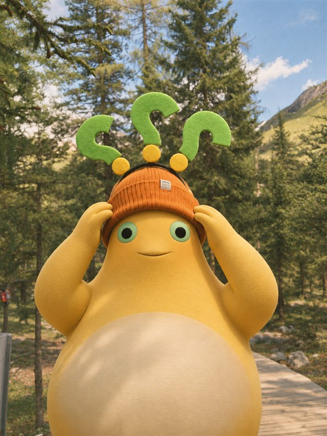
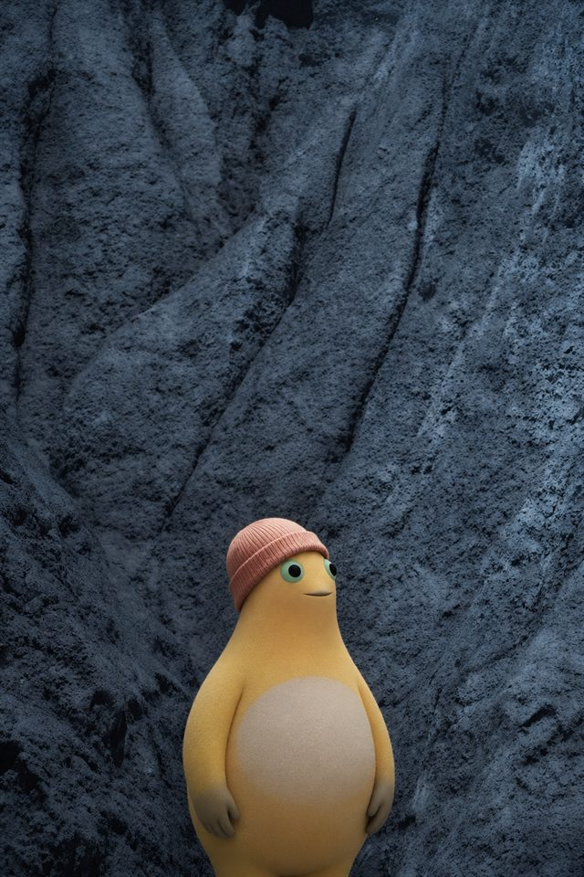
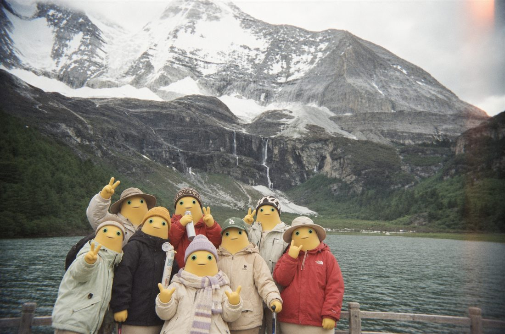

# 奶蛙照片替换 · Naiwa Photo Swap

把照片里的人换成奶蛙，让它像真的去过那个地方。

`naiwa-photo-swap` 是一个 Codex Skill：它会把用户照片当作场景底图，参考内置的奶蛙造型图，指导图像编辑工具替换指定人物。森林、岩壁、雪山和朋友们的合影都可以是奶蛙的下一站；帽子、衣服、道具和动作则由你决定。

> Skill 提供编辑规则、角色参考图和提示词模板，并不自带图像模型或 API 密钥。实际生成需要可用的图像编辑工具。

## 奶蛙出游现场

下面三张是生成结果。为了让 GitHub 页面加载更快，仓库中的效果图是这些成品的压缩预览；原始人物照片不随仓库发布。

<table>
  <tr>
    <td align="center"></td>
    <td align="center"></td>
  </tr>
  <tr>
    <td align="center"><strong>森林里冒出三个问号</strong><br>保留橙色帽子和问号装饰，沿用扶帽动作；衣服换成奶蛙原本的圆润身体。</td>
    <td align="center"><strong>岩壁前认真看风景</strong><br>只留下针织帽，让奶蛙的梨形轮廓完整露出；冷色岩壁继续做背景。</td>
  </tr>
</table>

<p align="center"></p>
<p align="center"><strong>八人合影，一个都不能少</strong><br>保留各自的站位、外套、帽子和手势，把整组人物变成奶蛙。</p>

## 你可以怎么指定

| 想控制什么 | 可以怎么说 |
| --- | --- |
| 替换范围 | “只换中间的人”“把合影里所有人都换掉”“只替换面部” |
| 衣服和配饰 | “保留帽子，不保留衣服”“只保留上半身外套”“背包和水瓶也留下” |
| 动作与表情 | “沿用原来的姿势”“抬手扶帽”“一只手托腮思考” |
| 场景细节 | “雪山、马匹和后面的人不要变”“保持原来的复古胶片色调” |

一句话里说清楚**换谁、留下什么、动作要不要变**，通常比只说“换成奶蛙”更容易得到想要的画面。

## 开始使用

将整个 `naiwa-photo-swap` 目录放到 Codex 的 Skills 目录。默认路径：

```text
~/.codex/skills/naiwa-photo-swap/
```

在 Windows 上，这通常对应 `%USERPROFILE%\.codex\skills\naiwa-photo-swap\`。保留目录内的 `SKILL.md`、`assets/` 和 `references/`；刷新或重新打开 Codex 后，附上照片并在对话中调用 Skill：

```text
$naiwa-photo-swap 把照片中的人物替换成奶蛙，保留橙色针织帽和头顶的问号，不保留衣服，沿用双手扶帽的动作。
```

```text
$naiwa-photo-swap 把合影中的八个人都替换成奶蛙，保留每个人的外套、帽子和手势，雪山与湖水保持原样。
```

```text
$naiwa-photo-swap 只保留上半身的黑色外套，让奶蛙露出稍微圆润的体型，一只手托腮思考。
```

照片中有多人时，记得指出是替换某一位，还是全部替换。若你另有奶蛙参考图，也可以一起提供；Skill 会优先采用你提供的版本。

## 它怎样避免“贴纸感”

1. **先分清图片的身份。** 用户照片是唯一的场景底图；角色图只用于参考奶蛙的造型、表情或动作。
2. **认准奶蛙。** 柔和的金黄色梨形身体、浅色肚皮、微凸的薄荷绿眼圈、黑色瞳孔与短圆四肢，是不能丢的辨识点。
3. **站回原来的位置。** 人物的大小、透视、遮挡和落地阴影要跟照片对上；背景中的人、动物、物品和构图尽量保留。
4. **一起“拍”进照片。** 光线、清晰度和细腻的 35mm 胶片颗粒要同时作用于奶蛙与环境，避免只有背景有滤镜。
5. **生成后再看一眼。** 检查人数、身体比例、保留的衣物道具与场景细节，发现具体问题再定向修改；成品另存，不覆盖原图。

完整规则在 [SKILL.md](SKILL.md)，需要组织编辑要求时可参考 [中文提示词模板](references/edit-prompt.md)。

## 仓库内容

```text
naiwa-photo-swap/
├── README.md
├── SKILL.md
├── assets/          # 奶蛙造型与表情参考图
├── references/      # 编辑提示词模板
└── examples/        # 本页展示的三张生成结果预览
```

## 照片与授权

请使用有权编辑的照片。向外部图像服务发送照片时，需要取得适用于该照片与服务的授权。公开发布这个 Skill 前，也请确认角色参考图与效果图的展示和再分发权限。这里没有预设开源许可证，也没有保存任何 API 密钥。
